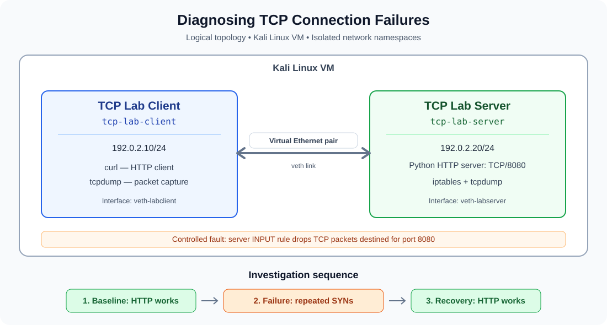
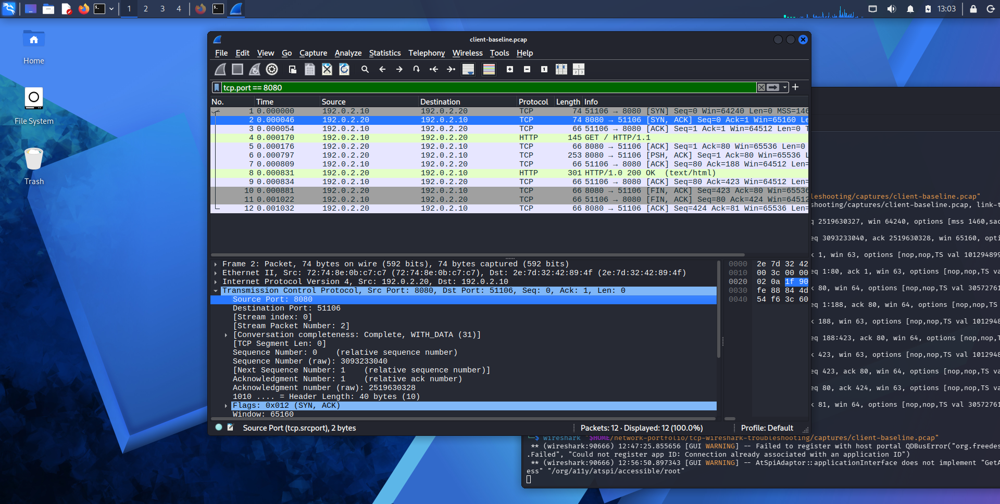
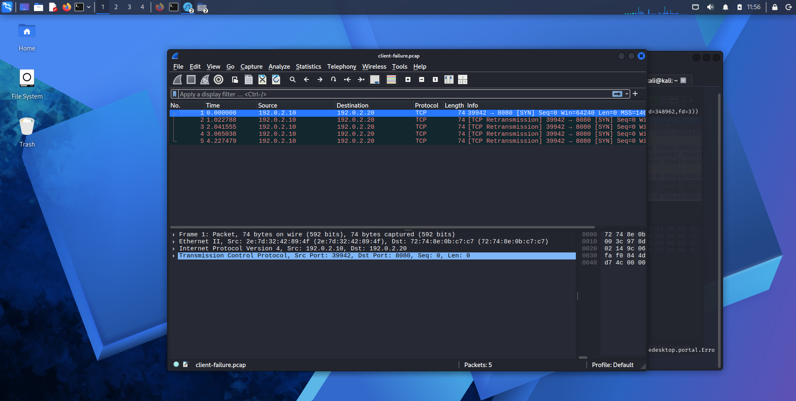
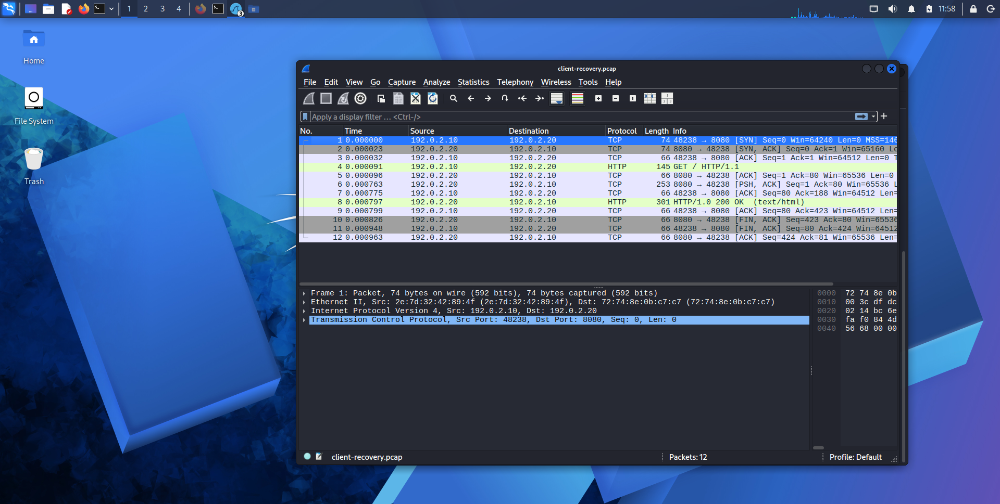

- **Project type:** Self-directed networking lab
- **Level:** Junior network engineer / CCNA
- **Environment:** Kali Linux, network namespaces, tcpdump, Wireshark and Python 3

## Overview

This project investigates a TCP connection failure using an isolated Linux client/server lab. I captured a successful HTTP exchange, introduced a controlled firewall rule that silently dropped TCP traffic destined for port 8080, examined packet captures at both endpoints, checked firewall counters and verified recovery after removing the rule.

The investigation demonstrates evidence-based troubleshooting and the importance of distinguishing symptoms from confirmed causes.

## Network topology



The client and server run in separate Linux network namespaces within one Kali Linux VM. A virtual Ethernet pair connects them directly; no router is required.

| Component | Configuration |
|---|---|
| Client namespace | `tcp-lab-client` |
| Client interface | `veth-labclient` |
| Client IPv4 address | `192.0.2.10/24` |
| Server namespace | `tcp-lab-server` |
| Server interface | `veth-labserver` |
| Server IPv4 address | `192.0.2.20/24` |
| Application | Python HTTP server |
| TCP destination port | `8080` |

The addresses are from `192.0.2.0/24`, a block reserved for documentation and examples.

## Investigation results

### 1. Baseline: successful connection

The baseline packet captures show the TCP three-way handshake, an HTTP GET request and a successful `HTTP/1.0 200 OK` response.



The client sent a SYN, received a SYN-ACK from the server and completed the handshake with an ACK. The HTTP request and response followed, and the TCP connection closed normally.

### 2. Failure: controlled firewall drop

I added this rule inside the server namespace's INPUT chain:

```bash
iptables -I INPUT 1 -p tcp --dport 8080 -j DROP
```

The client capture showed five SYN attempts to `192.0.2.20:8080` without a SYN-ACK or RST response. The server-side capture also showed the five incoming SYN attempts.

The firewall rule counter increased to **5 packets and 300 bytes**.



A missing response alone would not prove that a firewall caused the problem. The controlled rule, its counter, the working baseline and the subsequent recovery test provide the combined evidence for the diagnosis.

### 3. Recovery: successful connection restored

After removing the DROP rule and confirming that the Python HTTP server was listening on port 8080, I repeated the request. The client received `HTTP/1.0 200 OK` and the expected HTML page.

The recovery packet captures show the successful TCP three-way handshake, the HTTP request and response, and normal connection closure.



During recovery testing, an initial request was refused because no process was listening on port 8080. After restarting the HTTP server and confirming its listening socket, the request succeeded. This was a separate service-availability issue, not evidence that the removed DROP rule was still active.

## Packet captures

All six packet captures were generated during this lab.

| Stage | Client capture | Server capture |
|---|---|---|
| Baseline | [client-baseline.pcap](captures/client-baseline.pcap) | [server-baseline.pcap](captures/server-baseline.pcap) |
| Failure | [client-failure.pcap](captures/client-failure.pcap) | [server-failure.pcap](captures/server-failure.pcap) |
| Recovery | [client-recovery.pcap](captures/client-recovery.pcap) | [server-recovery.pcap](captures/server-recovery.pcap) |

Open a capture in Wireshark and use this display filter to isolate the test conversation:

```text
tcp.port == 8080
```

Other useful filters include:

```text
tcp.flags.syn == 1 && tcp.flags.ack == 0
```

This displays initial SYN packets.

```text
tcp.flags.syn == 1 && tcp.flags.ack == 1
```

This displays SYN-ACK packets.

```text
tcp.flags.reset == 1
```

This displays TCP reset packets, if any are present.

These are Wireshark display filters, not `tcpdump` capture filters.

## Skills demonstrated

- Linux network namespaces and virtual Ethernet interfaces
- IPv4 addressing and directly connected subnet communication
- TCP three-way handshake and connection teardown
- HTTP request and response analysis
- Packet capture at client and server endpoints
- Wireshark display filters
- `iptables` firewall rules and packet counters
- Root-cause investigation and recovery validation
- Technical documentation and evidence-based reporting

## Project files

- `captures/` — baseline, failure and recovery packet captures
- `docs/topology.svg` — logical network topology diagram
- `screenshots/` — Wireshark screenshots of the baseline, failure and recovery
- `scripts/` — directory reserved for lab setup, fault and cleanup automation
- `www/` — HTML page served by the Python HTTP server
- `README.md` — project overview, findings and evidence links

## Limitations

This is a self-directed, single-host lab with one HTTP service and a deliberately introduced firewall rule. It demonstrates endpoint-level TCP troubleshooting. It does not claim production experience or demonstrate physical switching, VLAN, WAN or advanced routing troubleshooting.

## Safety and scope

The test firewall rule was applied inside `tcp-lab-server`, not in Kali's main network namespace. The lab used documentation-only IPv4 addresses and did not require changes to a home router or production network.

## Evidence integrity

The findings are based on packet captures and command results collected during this lab. The packet captures and screenshots represent the actual experiment. Any frame numbers or additional packet-level claims included in future documentation should be checked against the saved captures rather than assumed.

## Supporting documentation

- [Incident report](docs/incident-report.md) — methodology, evidence, root cause and recovery.
- [Wireshark display filters](docs/filters.md) — filters and packet interpretation.
- [Evidence checklist](docs/evidence-checklist.md) — completed tests and pre-publication checks.
- [Network topology](docs/topology.svg) — logical client/server diagram.
